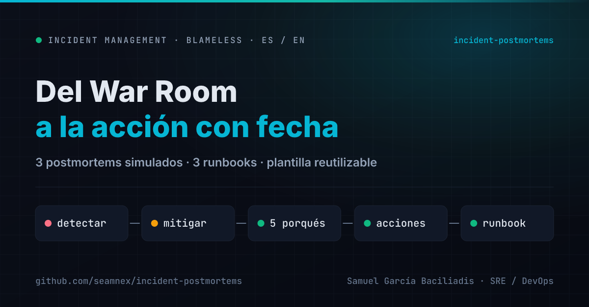
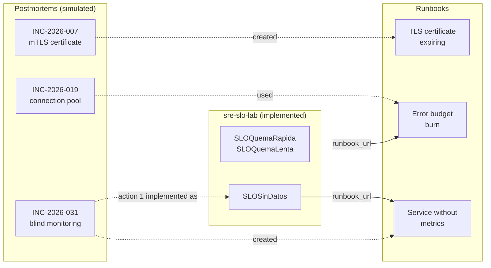

# Incident Postmortems — Incident management exercises

[](https://github.com/seamnex/incident-postmortems/actions/workflows/docs.yml)



[Español](README.md) · **English**

Three postmortems, three runbooks and a reusable template, in *blameless*
format, as practice in documenting P1/P2 incidents.

---

## Notice

> **The three incidents in this repository are SIMULATED.**
>
> Pagoya, its services, its teams, its metrics and every number in these
> documents are **fictional**. They don't describe incidents at any company I
> have worked for, nor at any real company. They are exercises: made-up but
> realistic scenarios, built to show **how** I document an incident, not
> **which** incidents I lived through.
>
> The roles listed as owners ("on-call SRE", "Payments Tech Lead") are generic
> roles, not people.

---

## Why this repository exists

A postmortem written to close the ticket —with a root cause that says "human
error" and action items with no owner or date— is the surest way for **the
same incident to come back**. These exercises are deliberate practice of the
opposite.

The format they follow:

- **Blameless.** Systems, decisions and signals are described, never people.
  If someone made a bad call with the information they had, the problem is the
  information they had.
- **Impact with numbers and sources.** "It affected many users" doesn't help
  decide anything.
- **5 whys until reaching something that can be changed.** If the answer is
  "human error", you're not there yet.
- **"Where we got lucky".** The most honest section of the document: what went
  well without anyone having designed it that way.
- **Three kinds of action items** —prevent, detect, mitigate— each with an
  owner and a date. If they're all of one kind, keep looking.

## Contents

### Postmortems

| ID | Incident | Sev | What makes it interesting |
|---|---|---|---|
| [INC-2026-007](postmortems/en/2026-03-14-expired-mtls-certificate.md) | Card payments rejected for 2 h 38 min due to an expired mTLS certificate | P1 | A renewal job failed **53 nights in a row** without an alert. Detection worked in 7 minutes; diagnosis lost 28 on the wrong hypothesis |
| [INC-2026-019](postmortems/en/2026-05-19-connection-pool-latency.md) | Slow balance queries for 58 min after a deploy | P2 | A database connection held during an external call. **20 minutes of impact** waiting to confirm the rollback was safe |
| [INC-2026-031](postmortems/en/2026-08-27-blind-monitoring-otp.md) | OTP codes undelivered for 80 min, without a single alert | P2 | Monitoring was **blind for 4 hours** after a network change, and being blind didn't alert. Support caught it |

### Runbooks

| Runbook | Alert | Created from |
|---|---|---|
| [Error budget burn](runbooks/en/error-budget-burn.md) | `SLOQuemaRapida`, `SLOQuemaLenta` | INC-2026-019 |
| [Service without metrics](runbooks/en/service-without-metrics.md) | `SLOSinDatos` | INC-2026-031 |
| [TLS certificate expiring or expired](runbooks/en/tls-certificate-expiring.md) | `CertificadoPorVencer` | INC-2026-007 |

The `SLOQuemaRapida`, `SLOQuemaLenta` and `SLOSinDatos` alerts really exist,
with tests, in the [sre-slo-lab](https://github.com/seamnex/sre-slo-lab), and
their `runbook_url` annotation points to these documents (Spanish versions).
`CertificadoPorVencer` is part of the exercise: it isn't implemented in any lab.

### Template

[`plantilla/postmortem.en.md`](plantilla/postmortem.en.md) — with the writing
rules as comments. Also in [Spanish](plantilla/postmortem.es.md).

## How they relate



## What the three show together

Read together, the three incidents share a pattern that isn't accidental:

1. **The failure itself is rarely what makes the incident severe.** A
   certificate expires, a mock is faster than reality, a provider throttles
   messages: these things happen. What turns them into hours-long incidents is
   **the time to find out** (INC-031), **the time to understand** (INC-007) or
   **the time to dare to act** (INC-019).

2. **All three had the signal available earlier.** 53 renewal job failures, a
   pool at 100% fourteen minutes before the alert, a target `down` for two
   hours. The problem wasn't a lack of data: it was that nothing turned it into
   an alert.

3. **Detection actions shorten incidents the most.** Of the 23 action items
   across the three postmortems, 7 are about finding out sooner, and they're
   the ones that would have cut all three incidents short. Preventing every
   possible failure is impossible; finding out quickly about any of them isn't.

## Automated checks

Every push and PR goes through [`.github/workflows/docs.yml`](.github/workflows/docs.yml):

| Check | What it catches |
|---|---|
| `markdownlint-cli2` | Inconsistent Markdown: headings, lists, tables |
| `lychee --offline` | Broken links between documents: a runbook that was renamed and a postmortem still pointing to the old name |
| ES/EN parity | Every Spanish document has its English version, and vice versa |

## Structure

```text
incident-postmortems/
├── postmortems/
│   ├── es/            # the three postmortems in Spanish
│   └── en/            # and in English
├── runbooks/
│   ├── es/
│   └── en/
├── plantilla/         # template
│   ├── postmortem.es.md
│   └── postmortem.en.md
├── scripts/
│   └── paridad.sh     # checks that ES and EN have the same documents
├── .github/workflows/
│   └── docs.yml
└── README.en.md       # this file · README.md in Spanish
```

## License

[CC BY 4.0](https://creativecommons.org/licenses/by/4.0/): you can reuse the
template and runbooks with attribution.
