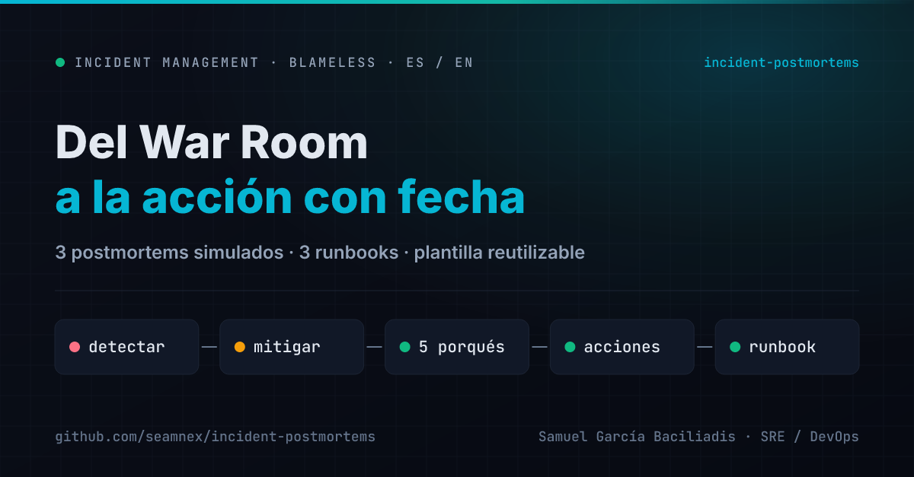
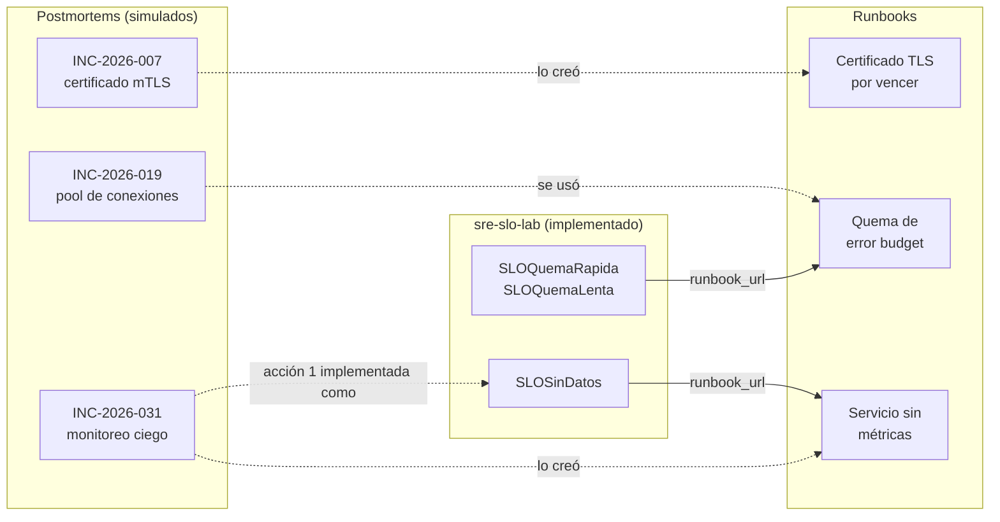

# Incident Postmortems — Ejercicios de gestión de incidentes

[](https://github.com/seamnex/incident-postmortems/actions/workflows/docs.yml)



**Español** · [English](README.en.md)

Tres postmortems, tres runbooks y una plantilla reutilizable, en formato
*blameless* (sin culpables), como práctica de documentación de incidentes P1/P2.

---

## Aviso

> **Los tres incidentes de este repositorio son SIMULADOS.**
>
> Pagoya, sus servicios, sus equipos, sus métricas y cada número de estos
> documentos son **ficticios**. No describen incidentes de ninguna empresa en
> la que haya trabajado ni de ninguna empresa real. Son ejercicios: escenarios
> inventados pero realistas, construidos para mostrar **cómo** documento un
> incidente, no **qué** incidentes viví.
>
> Los roles que aparecen como responsables ("SRE de guardia", "Líder técnico de
> Pagos") son roles genéricos, no personas.

---

## Por qué existe este repositorio

Un postmortem escrito para cerrar el ticket —con una causa raíz que dice
"error humano" y acciones sin dueño ni fecha— es la forma más segura de que
**el mismo incidente vuelva**. Estos ejercicios son práctica deliberada de lo
contrario.

Estos ejercicios muestran el formato que considero que funciona:

- **Sin culpables.** Se describen sistemas, decisiones y señales, nunca
  personas. Si alguien tomó una mala decisión con la información que tenía, el
  problema es la información que tenía.
- **Impacto con números y con fuente.** "Afectó a muchos usuarios" no ayuda a
  decidir nada.
- **5 porqués hasta llegar a algo que se pueda cambiar.** Si la respuesta es
  "error humano", todavía no se llegó.
- **"Dónde tuvimos suerte".** La sección más honesta del documento: lo que
  salió bien sin que nadie lo hubiera diseñado así.
- **Acciones de tres tipos** —prevenir, detectar, mitigar— con responsable y
  fecha. Si todas son de un solo tipo, falta mirar.

## Contenido

### Postmortems

| ID | Incidente | Sev | Lo que lo hace interesante |
|---|---|---|---|
| [INC-2026-007](postmortems/es/2026-03-14-certificado-mtls-vencido.md) | Pagos con tarjeta rechazados 2 h 38 min por un certificado mTLS vencido | P1 | Un job de renovación falló **53 noches seguidas** sin una alerta. La detección funcionó en 7 minutos; el diagnóstico se perdió 28 en una hipótesis equivocada |
| [INC-2026-019](postmortems/es/2026-05-19-latencia-pool-de-conexiones.md) | Consultas de saldo lentas 58 min después de un deploy | P2 | Una conexión a la base retenida durante una llamada externa. **20 minutos de impacto** esperando confirmar que el rollback era seguro |
| [INC-2026-031](postmortems/es/2026-08-27-monitoreo-ciego-otp.md) | Códigos OTP sin entregar 80 min, sin una sola alerta | P2 | El monitoreo estuvo **ciego 4 horas** por un cambio de red, y estar ciego no alertaba. Lo detectó soporte |

### Runbooks

| Runbook | Alerta | Creado a partir de |
|---|---|---|
| [Quema de error budget](runbooks/es/quema-de-error-budget.md) | `SLOQuemaRapida`, `SLOQuemaLenta` | INC-2026-019 |
| [Servicio sin métricas](runbooks/es/servicio-sin-metricas.md) | `SLOSinDatos` | INC-2026-031 |
| [Certificado TLS por vencer o vencido](runbooks/es/certificado-tls-por-vencer.md) | `CertificadoPorVencer` | INC-2026-007 |

Las alertas `SLOQuemaRapida`, `SLOQuemaLenta` y `SLOSinDatos` existen de verdad,
con tests, en el [sre-slo-lab](https://github.com/seamnex/sre-slo-lab), y su
anotación `runbook_url` apunta a estos documentos. `CertificadoPorVencer` es
parte del ejercicio: no está implementada en ningún lab.

### Plantilla

[`plantilla/postmortem.es.md`](plantilla/postmortem.es.md) — con las reglas de
escritura en comentarios. También en [inglés](plantilla/postmortem.en.md).

## Cómo se relacionan



## Lo que muestran los tres juntos

Leídos en conjunto, los tres incidentes tienen un patrón que no es casual:

1. **La falla en sí casi nunca es lo que hace grave al incidente.** Un
   certificado vence, un mock es más rápido que la realidad, un proveedor
   limita envíos: son cosas que pasan. Lo que convierte a esas fallas en
   incidentes de horas es **el tiempo hasta enterarse** (INC-031), **el tiempo
   hasta entender** (INC-007) o **el tiempo hasta animarse a actuar** (INC-019).

2. **Los tres tenían la señal disponible antes.** 53 fallas del job de
   renovación, un pool al 100 % catorce minutos antes de la alerta, un target
   `down` durante dos horas. El problema no fue la falta de datos: fue que
   nadie los convertía en una alerta.

3. **Las acciones que más acortan son las de detección.** De las 23 acciones
   de los tres postmortems, 7 son para enterarse antes, y son las que habrían
   recortado los tres incidentes. Prevenir cada falla posible es imposible;
   enterarse rápido de cualquiera, no.

## Validación automática

Cada push y PR pasa por [`.github/workflows/docs.yml`](.github/workflows/docs.yml):

| Verificación | Qué atrapa |
|---|---|
| `markdownlint-cli2` | Formato Markdown inconsistente: títulos, listas, tablas |
| `lychee --offline` | Links rotos entre documentos: un runbook que cambió de nombre y un postmortem que todavía apunta al viejo |
| Paridad ES/EN | Que cada documento en español tenga su versión en inglés, y al revés |

## Estructura

```text
incident-postmortems/
├── postmortems/
│   ├── es/            # los tres postmortems en español
│   └── en/            # y en inglés
├── runbooks/
│   ├── es/
│   └── en/
├── plantilla/
│   ├── postmortem.es.md
│   └── postmortem.en.md
├── scripts/
│   └── paridad.sh     # verifica que ES y EN tengan los mismos documentos
├── .github/workflows/
│   └── docs.yml
└── README.md          # este archivo · README.en.md en inglés
```

## Licencia

[CC BY 4.0](https://creativecommons.org/licenses/by/4.0/): podés reutilizar la
plantilla y los runbooks citando la fuente.
